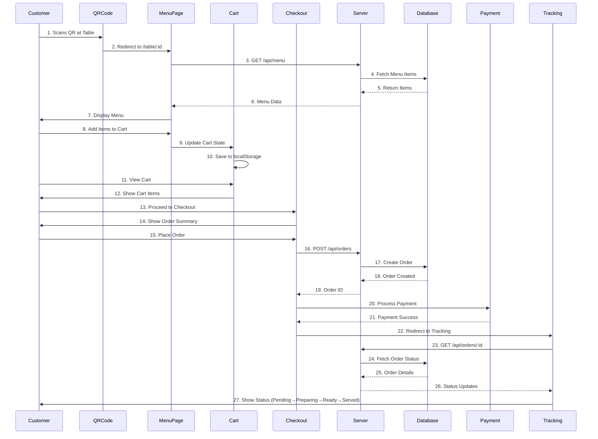
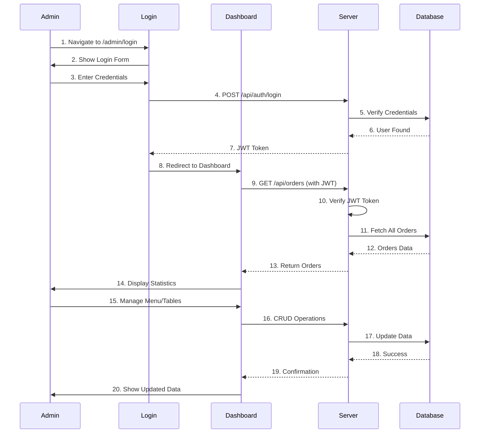
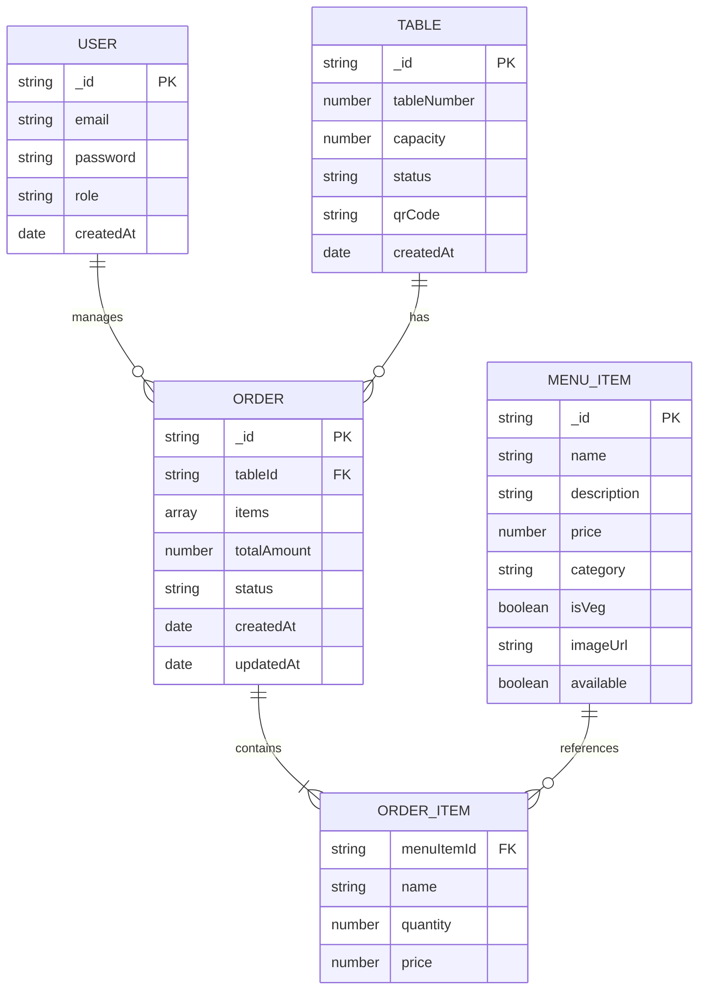
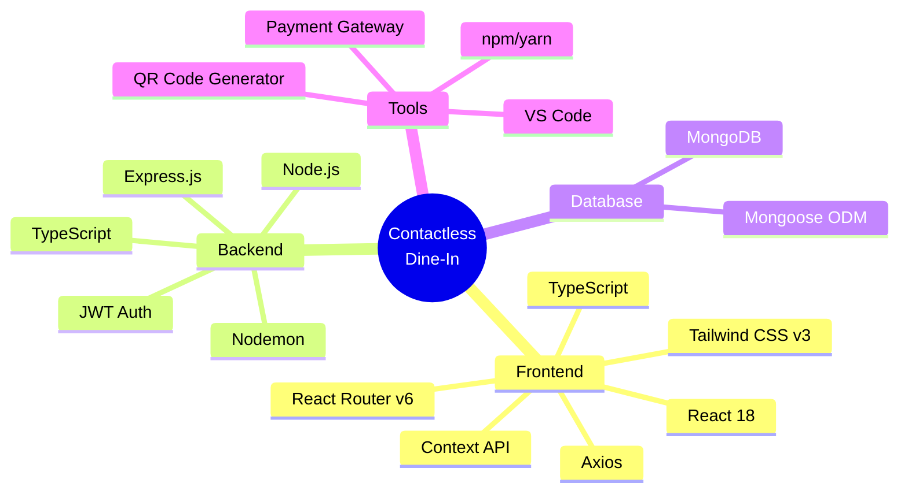
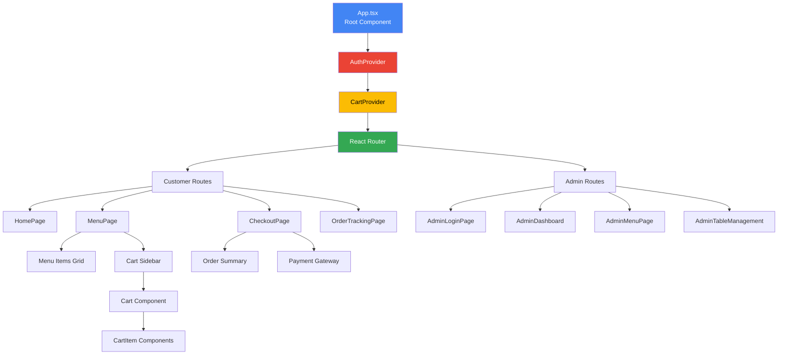

# Contactless Dine-In Architecture Flow Diagram

## System Architecture

```mermaid
graph TB
    subgraph "Client Layer - React Frontend"
        QR[QR Scanner/HomePage]
        Menu[MenuPage<br/>Browse & Filter Menu]
        Cart[Cart Sidebar<br/>View/Edit Cart]
        Checkout[CheckoutPage<br/>Order Summary]
        Tracking[OrderTrackingPage<br/>Real-time Status]
        AdminLogin[AdminLoginPage]
        AdminDash[AdminDashboard]
        AdminMenu[AdminMenuPage]
        AdminTable[AdminTableManagement]
        
        CartCtx[CartContext<br/>Global Cart State]
        AuthCtx[AuthContext<br/>Admin Auth State]
    end
    
    subgraph "API Layer - Express Routes"
        QRRoute[/api/qr<br/>Generate QR Codes]
        MenuRoute[/api/menu<br/>CRUD Menu Items]
        OrderRoute[/api/orders<br/>Create & Track Orders]
        TableRoute[/api/tables<br/>Manage Tables]
        AuthRoute[/api/auth<br/>Admin Login]
        PaymentRoute[/api/payment<br/>Payment Processing]
    end
    
    subgraph "Server Layer - Node.js"
        MenuCtrl[Menu Controller]
        OrderCtrl[Order Controller]
        TableCtrl[Table Controller]
        QRCtrl[QR Controller]
        
        AuthMiddleware[Auth Middleware<br/>JWT Verification]
        Validator[Validator Middleware]
        ErrorHandler[Error Handler]
    end
    
    subgraph "Database Layer - MongoDB"
        UsersDB[(users<br/>Admin Credentials)]
        MenuDB[(menuItems<br/>Food Items)]
        TablesDB[(tables<br/>Table Info & QR)]
        OrdersDB[(orders<br/>Order Details)]
    end
    
    %% Customer Flow
    QR -->|Scan QR Code<br/>table/:id| Menu
    Menu --> CartCtx
    CartCtx --> Cart
    Cart -->|Proceed to<br/>Checkout| Checkout
    Checkout --> PaymentRoute
    PaymentRoute -->|Payment Success| Tracking
    
    %% Admin Flow
    AdminLogin --> AuthRoute
    AuthRoute --> AuthCtx
    AuthCtx --> AdminDash
    AdminDash --> AdminMenu
    AdminDash --> AdminTable
    
    %% API Connections - Customer
    Menu --> MenuRoute
    Checkout --> OrderRoute
    Tracking --> OrderRoute
    QR --> QRRoute
    
    %% API Connections - Admin
    AdminMenu --> MenuRoute
    AdminTable --> TableRoute
    AdminDash --> OrderRoute
    
    %% Server Layer
    MenuRoute --> AuthMiddleware
    OrderRoute --> Validator
    TableRoute --> AuthMiddleware
    QRRoute --> QRCtrl
    AuthRoute --> ErrorHandler
    
    AuthMiddleware --> MenuCtrl
    AuthMiddleware --> TableCtrl
    Validator --> OrderCtrl
    
    %% Database Connections
    MenuCtrl --> MenuDB
    OrderCtrl --> OrdersDB
    TableCtrl --> TablesDB
    QRCtrl --> TablesDB
    AuthRoute --> UsersDB
    
    style QR fill:#e1f5ff
    style Menu fill:#e1f5ff
    style Cart fill:#e1f5ff
    style Checkout fill:#e1f5ff
    style Tracking fill:#e1f5ff
    style AdminLogin fill:#ffe1e1
    style AdminDash fill:#ffe1e1
    style AdminMenu fill:#ffe1e1
    style AdminTable fill:#ffe1e1
    style CartCtx fill:#fff3e1
    style AuthCtx fill:#fff3e1
    style UsersDB fill:#e8f5e9
    style MenuDB fill:#e8f5e9
    style TablesDB fill:#e8f5e9
    style OrdersDB fill:#e8f5e9
```

## Customer User Flow



## Admin User Flow



## Data Models



## Technology Stack



## Component Hierarchy



---

## How to View This Diagram

### Option 1: VS Code Preview
1. Install "Markdown Preview Mermaid Support" extension
2. Open this file in VS Code
3. Press `Ctrl+Shift+V` (or `Cmd+Shift+V` on Mac)

### Option 2: Online Viewer
1. Copy the Mermaid code
2. Go to https://mermaid.live/
3. Paste and view the interactive diagram

### Option 3: GitHub
- Push this file to GitHub and it will render automatically

---

## Quick Reference

**Customer Journey:** QR Scan → Menu → Cart → Checkout → Payment → Order Tracking

**Admin Journey:** Login → Dashboard → Manage Menu/Tables/Orders

**Tech Stack:** MERN + TypeScript + Tailwind CSS

**Key Features:** QR-based ordering, Real-time tracking, Admin dashboard, Secure authentication
